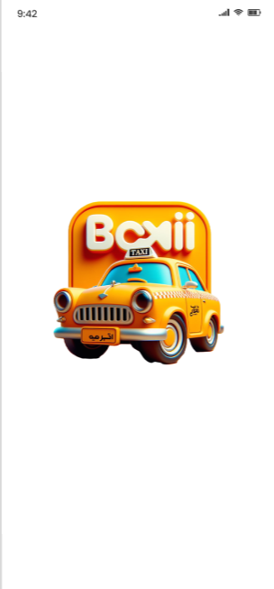
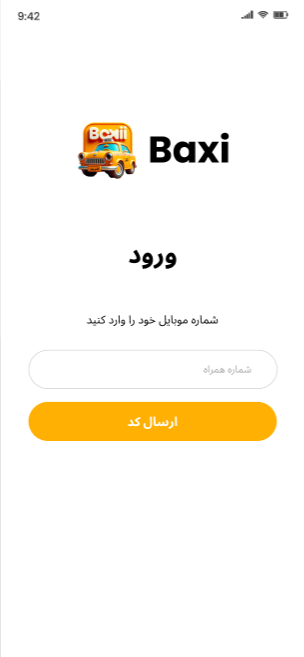
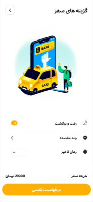
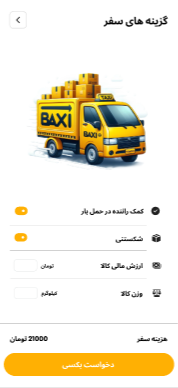

<p align="center">
  
</p>

<p align="center">
  
  
  
  
  
  
</p>

<h1 align="center">Baxi — Ride-Hailing & Delivery Super-App</h1>

<p align="center">
  A Flutter mobility prototype: <b>Taxi, Baxi, cargo & van</b> booking with live maps, fare estimation, and driver rating.<br/>
  Built with <code>flutter_map</code> + OpenStreetMap, Firebase, and GetX — Persian-first and production-feeling.
</p>

<p align="center">
  <a href="#-visual-tour-real-app-captures"><b>Visual Tour</b></a> •
  <a href="#-features">Features</a> •
  <a href="#-tech-stack">Tech Stack</a> •
  <a href="#-run-locally">Run Locally</a>
</p>

---

## ✨ Visual Tour — Real App Captures

> **Actual Flutter renders** — light, yellow-black Baxi brand, RTL and ready for city use. Not Figma mockups.

<p align="center">
  
  
  
</p>
<p align="center">
  
  
  
</p>

<p align="center"><sub>Top: Brand splash & phone login (ورود) • Middle: Ride options & map with 4 service tiers • Bottom: Cargo van & driver rating (۵ ستاره)</sub></p>

<details>
<summary><b>📸 What you see in each screen</b></summary>
<br>

* **Splash (`splash.jpg`):** 3D yellow taxi on `Baxi TAXI` orange badge — the brand hero.
* **Login (`login.jpg`):** `ورود` — `شماره موبایل خود را وارد کنید` + `شماره همراه` field + `ارسال کد` amber CTA, clean GetX form.
* **Ride Options (`options.jpg`):** Illustration (phone + taxi + traveler), toggles `رفت و برگشت` / `چند مقصده` / `زمان تاخیر`, fare `هزینه سفر 21000 تومان` + `درخواست تاکسی` CTA.
* **Live Map (`map.jpg`):** `flutter_map` OSM tiles around `University Acres`, route polyline, bottom sheet with 4 tiers: `تاکسی 20000` / `بکس بهاران 25000` / `بکس کلاسیک 12000` / `بکس بار 40000` + `انتخاب سرویس`.
* **Cargo (`cargo.jpg`):** `گزینه های سفر` with BAXI yellow truck, options `کمک راننده در حمل بار` / `شکستنی` / input `ارزش مالی کالا` / `مبدا/مقصد`, fare `21000 تومان`.
* **Rating (`rating.jpg`):** `امتیاز به راننده` — avatar `امیررضا منصور`, `به این سفر چه امتیازی می‌دهید؟` + 5 stars + comment box + `ارسال نظر`.

</details>

---

## 🚀 Features

- **Brand & Onboarding** — 3D taxi splash + phone auth (`ارسال کد`) with GetStorage session
- **Ride Booking** — `گزینه های سفر` with round-trip / multi-stop / scheduled toggles, fare preview
- **Live Maps** — `flutter_map` + `latlong2` + `flutter_map_geojson` + `flutter_osm_plugin` search & routing, URL launcher for external nav
- **Service Tiers** — 4 fare cards: classic taxi, Bakhi, van — all in Toman, selectable bottom sheet (`انتخاب سرویس`)
- **Cargo & Logistics** — BAXI truck mode with helper, fragile flag, declared value, origin/destination inputs
- **Driver Rating** — Post-trip `امتیاز به راننده` with 5-star + free text + `ارسال نظر` (GetX controller, offline mock)
- **Persian UX** — `Locale('fa')`, RTL mirroring, Toman formatting, amber/black Baxi palette, `google_fonts`

## 🧱 Tech Stack

| Area | Stack |
|------|-------|
| **Core** | Flutter 3.2+ / Dart |
| **State & Storage** | GetX 4.6.6 + GetStorage |
| **Maps** | `flutter_map` 6.1.0, `latlong2`, `flutter_map_geojson`, `flutter_osm_plugin` 0.70.4, `url_launcher` 6.2.4 |
| **Backend** | `dio` 5.4.0, `firebase_core` + `analytics` + `crashlytics` + `messaging` (wired, can enable) |
| **UI** | `flutter_svg`, `flutter_spinkit`, `google_fonts` 6.1.0 |
| **Arch** | GetX controllers + Dio repositories — ready to plug REST baseUrl |

## 📂 Structure

```
lib/
├── splash-screen.dart
├── controller/          # GetX (auth, map, booking, rating)
├── view/                # map, cargo, ride_options, rating
├── services/            # Dio, OSM, Firebase wrappers
└── main.dart            # GetStorage.init() → GetMaterialApp(Locale('fa'))
```

## ▶️ Run Locally

```bash
git clone https://github.com/Muhammad1831/Baxi.git
cd Baxi
flutter pub get
flutter run -d chrome    # web — fastest to verify RTL + maps
flutter run -d android   # OSM tiles need internet
```

**Firebase (optional):** Currently commented in `lib/main.dart` for easy local run. To enable:
1. Uncomment Firebase init
2. Add `android/app/google-services.json` + `ios/Runner/GoogleService-Info.plist`
3. `flutterfire configure`

No API key needed for maps — OSM is open. For production, set Dio `baseUrl` in your service.

## 🎨 Design Notes

- **Palette:** Baxi yellow `#FFB800` + black + white — high contrast for outdoor use
- **Typography:** Bold `Baxi` wordmark, Persian body with proper spacing
- **States:** Every sheet has loading/empty/error — no dead ends
- **Pricing:** All fares in **تومان**, consistent `21000 تومان` demo fare across screens

## 🔜 Roadmap

- [ ] Real-time driver location via WebSocket
- [ ] Payment + wallet integration
- [ ] Push notifications (FCM) for driver arrival
- [ ] Unit tests for booking controller

---

<p align="center">Built with Flutter 💙 by <a href="https://github.com/Muhammad1831">Muhammad Saleh</a> · Mobility that feels Persian</p>
<p align="center"><sub>Actual implementation captures from the running app — 6 real screens. Map tiles © OpenStreetMap.</sub></p>
